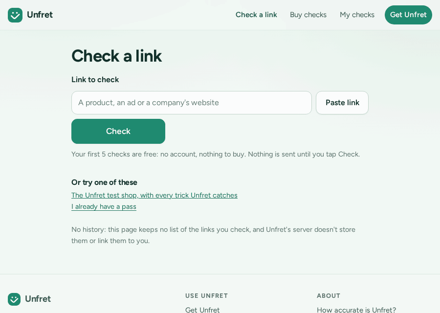

# Unfret for Android



Check a product page, a second-hand ad or a service provider's page from your phone. Share a link to Unfret (from
a browser, Marktplaats, Vinted, eBay, Facebook or any other app) or paste it in the app. The page opens inside
Unfret, **on your phone, over your own connection**, so shops that refuse servers still show it and you can deal
with a cookie banner or a captcha yourself. When the page shows what you want to check, tap **Check this page**:
Unfret reads it on the phone and tells you in plain words whether it all adds up.

Android only. English. No ads, no trackers, no Google Play Services, no analytics or crash reporting.

- Website: [unfret.net](https://unfret.net) · [check a link](https://unfret.net/check) ·
  [developers and AI agents](https://unfret.net/developers)
- The service behind it (API, website, scoring):
  [git.kroshtan.com/kroshtan/unfret_backend](https://git.kroshtan.com/kroshtan/unfret_backend) ·
  [GitHub mirror](https://github.com/kroshtan/unfret_backend)
- Browser extension: [git.kroshtan.com/kroshtan/unfret_extension](https://git.kroshtan.com/kroshtan/unfret_extension) ·
  [GitHub mirror](https://github.com/kroshtan/unfret_extension)
- This app: [git.kroshtan.com/kroshtan/unfret_android](https://git.kroshtan.com/kroshtan/unfret_android) ·
  [GitHub mirror](https://github.com/kroshtan/unfret_android)

## How accurate it is

The app reads the page; the verdict comes from the Unfret service. On Unfret's labelled corpus of **1,582 product
pages** (scam shops, junk and dropshipping, and legitimate shops), replayed through the analysis with the open
baseline model, the score has a **ROC AUC of 0.897**:

| Verdict | Pages | Scam or junk among them |
| --- | --- | --- |
| Serious concerns | 282 | 95% |
| Think twice | 423 | 82% |
| Worth a look | 404 | 46% |
| Looks fine | 464 | 7% |

Think twice or Serious concerns catches 74% of the scam and junk pages, with 12% of legitimate pages getting one
(false alarms). The corpus includes the pages the model was trained on, so expect somewhat lower numbers on new pages;
details in the [backend's README](https://git.kroshtan.com/kroshtan/unfret_backend#how-accurate-it-is).

**The model.** The scoring model in the backend repository is an open baseline, and a self-hosted Unfret uses it.
The service at unfret.net runs privately retrained versions of it. The labelled corpus and the duplicate-product image
dataset are private.

## Run it against your own server

Release builds talk to unfret.net only. To use your own Unfret (the backend's
[self-host steps](https://git.kroshtan.com/kroshtan/unfret_backend#run-your-own)), serve it over HTTPS, put its
address in `UnfretApi.DEV` (`app/src/main/java/net/unfret/android/UnfretApi.kt`), build a debug APK (`make apk`,
see [Building](#building)) and turn on the app's dev-server switch.

## Privacy, in plain words

- **Nothing is read until you tap Check this page.** Loading a page sends nothing to Unfret.
- **The page is read on your phone**, by the same code as the Unfret browser extension
  ([extractor/](extractor/README.md)): product facts and the visible text, from a copy of the page. Account menus,
  greetings, forms and their fields, checkout, billing and delivery areas, and any address that isn't the
  business's own are removed first. On a private seller's ad the seller's name is never read.
- **Sent, only to unfret.net:** the page address, those facts and that text, and your Unfret pass. No device details
  (the app identifies itself as `Unfret-Android/<version>`, not your phone's model), no location, no contacts.
- **Kept on the phone:** your key (encrypted with a key in the Android Keystore), whether you accepted the intro,
  and nothing else. The pages you open are forgotten: the WebView runs in its own process, and when you close the
  page its cookies, storage, cache and other files are deleted and that process ends. Nothing goes into Android
  backups.

The full statement is [PRIVACY.md](PRIVACY.md).

## Checks and your key

Each check uses one check from your Unfret pass (an API key, `ufk_…`). Paste the pass once; the app shows how many checks are
left. **Nothing is sold in the app**: "Get checks" and "Have a code?" open unfret.net's checkout in your browser,
where checks are bought or a code is redeemed onto a pass.

## How it works

```
share sheet / pasted link ─► CheckActivity (process :check)
    WebView, visible: the page over the phone's connection (HTTPS only; JavaScript on for this page only)
    "Check this page" ─► evaluateJavascript(assets/unfret-extract.js) ─► poll ─► {facts, text}
                     ─► POST https://unfret.net/v1/analyze/stream  (Bearer ufk_…)  ─► steps ─► verdict
    close ─► WebView data deleted, process ends
```

- `app/src/main/java/net/unfret/android/`: `CheckActivity` (WebView and check), `MainActivity` (intro, link field,
  key and checks), `ResultView` (the verdict), `UnfretApi` + `HttpUrlTransport` (the API over HttpURLConnection;
  HTTPS, unfret.net only, no redirects), `PageReading` + `AnalyzeRequest` (the reader's answers, and the request as
  the extension builds it), `KeyVault` + `KeystoreBox` (the key), `SharedLink` (the link in shared text).
- Native Android Views with Material 3 (Material Components), not Compose: the app is three screens, a WebView sits
  naturally in a View hierarchy, and it keeps the APK and the dependency list small (AppCompat and Material,
  nothing else).
- No JavaScript interface is exposed to the page: the app asks the reader for its result with
  `evaluateJavascript` polls, so a page's scripts get nothing to call.
- The API contract is the backend's `docs/api-contract-v1.md`; the app uses `GET /v1/credits` and
  `POST /v1/analyze/stream`, with the extension's request body and its plain-words error messages.

Debug builds have a switch for the dev deployment (dev.unfret.net, test network); release builds always use
unfret.net.

## Building

Nothing to install but docker: every step runs in pinned images (JDK 21 and the Android SDK from
`ghcr.io/cirruslabs/android-sdk:36`, and Node 22), pinned by digest in the `Makefile`. Gradle comes from the
wrapper (9.9.1, checksum-verified).

```bash
make apk        # debug APK at dist/unfret-<version>-debug.apk
make test       # JVM unit tests, and the bundled extractor over the extension's fixture pages
make lint       # Android lint (warnings are errors) and the bundle-matches-its-commit check
make check      # all of the above, as CI runs it
make extractor  # rebuild the page reader from the extension commit in extractor/EXTENSION_COMMIT
```

Install the debug APK with `adb install dist/unfret-0.1.0-debug.apk`, or copy it to a phone and open it (allow
installing from that source).

CI (`.forgejo/workflows/ci.yaml`, runner `kroshtan-public`) runs the same checks in the same images. Releases and
signing: [docs/RELEASING.md](docs/RELEASING.md).

## License

MIT, see [LICENSE](LICENSE).
